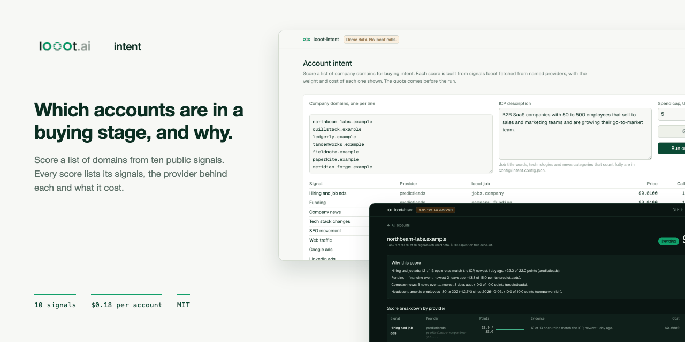
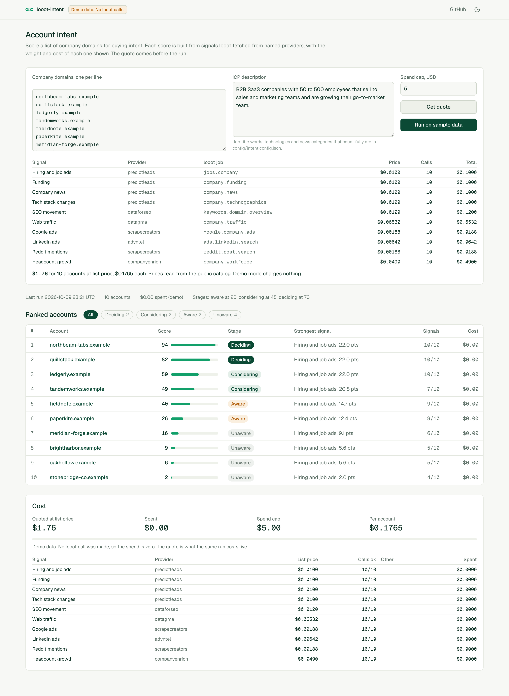
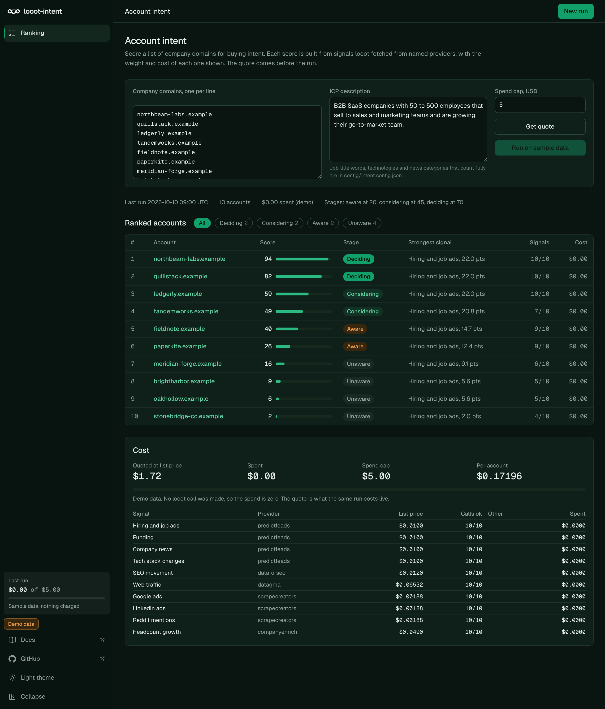
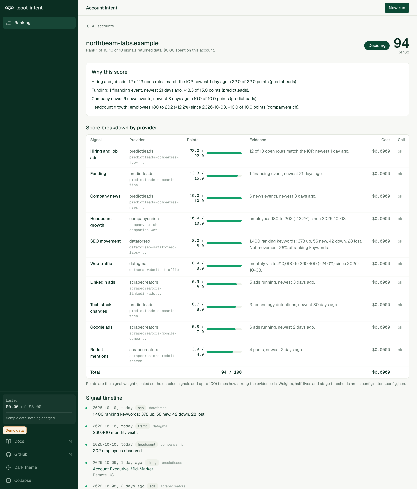
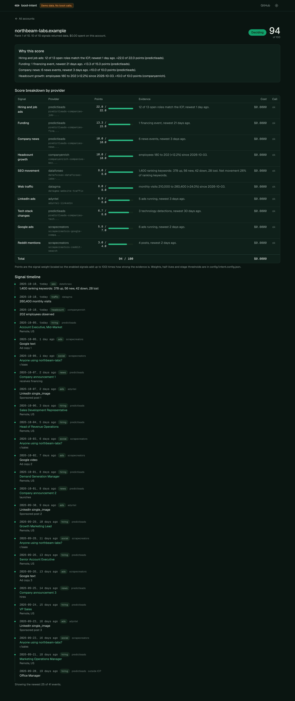

<p align="center"></p>

# looot-intent

[](LICENSE) [](https://github.com/loootai/looot-intent/releases) [](https://docs.looot.ai)

An open-source alternative to [6sense](https://6sense.com) for account intent and buying-stage scoring. 6sense publishes no price for paid plans and has a free plan with 50 credits a month; the only paid-plan figure found is a third-party estimate of about $25,000 a year (read 2026-10-10), not a 6sense number. looot-intent scores a list of company domains on one [looot](https://looot.ai) key and shows what each score cost.



## What it does

Give it company domains and an ICP description. For each account it calls ten looot endpoints from nine signal categories, turns the answers into a 0 to 100 intent score and a buying stage (unaware, aware, considering, deciding), and ranks the accounts.

- Every score lists the signals behind it, the provider that supplied each one, its weight in points and what the call cost.
- Weights, half-lives and stage thresholds live in `config/intent.config.json`. Edit the file, re-run.
- The quote comes first. A per-run spend cap is enforced before each call, and a stable idempotency key means a re-run in the same window replays finished calls at no charge.
- A call still running when waiting stops is `pending`, never "failed at $0".

Three ways to run it: a demo with sample data, a headless CLI, and a web UI on the same engine.

| Page | Light | Dark |
| --- | --- | --- |
| Ranking, quote and cost panel |  |  |
| Account page with timeline |  |  |

## What you need

- Node.js 20.9 or later to run the app and the CLI (Next.js 16 requires it). The tests need Node 22.12 or later (vitest 5). The repo has no `engines` field or `.nvmrc`; I ran everything on Node 24.18.
- Git and npm.
- For real runs only, a looot account and token. Sign up at https://looot.ai/auth/sign-up. Then either run `npm i -g looot` and `looot login`, which opens a browser approval, or open the looot web app, go to Settings, "Agent tokens" and create one ([sign-in docs](https://docs.looot.ai/get-started/sign-in)). With no browser (CI), create the token in Settings > Agent tokens and `export LOOOT_TOKEN=...`.
- The token needs the scopes `runs.execute`, `catalog.read`, `runs.read` and `usage.read`.
- A funded balance. The minimum top-up is $5 and signing up adds no credit ([money docs](https://docs.looot.ai/money)).

No other account is used. There is no Supabase, no database and no LLM key.

## Try it in one minute

```bash
git clone https://github.com/loootai/looot-intent && cd looot-intent
npm install --ignore-scripts
npm run demo
```

Open http://localhost:3271. The demo uses generated accounts on the reserved `.example` domain, needs no token, makes no network call and costs nothing. Stop it with Ctrl+C.

Prefer the terminal? `npm run intent -- --demo` prints the same ranking and writes the reports to `./out`.

## Run it with your own data

The web UI reads `.env.local`, the CLI does not. For the CLI, `export` the variables in your shell.

```bash
cp .env.example .env.local     # web UI only
```

| Variable | Needed | What it does | Where to get it |
| --- | --- | --- | --- |
| `LOOOT_TOKEN` | Required for real runs | Your looot key. Not needed for `--demo` or `--dry-run`. | looot Settings > Agent tokens, or `looot login` |
| `LOOOT_API_URL` | Optional | Overrides the API base. Default `https://api.looot.ai`. | Leave unset |
| `LOOOT_INTENT_CONFIG` | Optional | Path to a scoring config for the web UI. Default `config/intent.config.json`. The CLI takes `--config` instead. | Copy `config/intent.config.json` |
| `LOOOT_INTENT_DIR` | Optional | Folder for the saved run (`state.json`). Default `.looot-intent` in the working directory. | Any writable folder |
| `LOOOT_INTENT_DEMO` | Optional | `1` runs the web UI on sample data. `npm run demo` sets it. | Leave unset for real data |

Example inputs are in `examples/`. `examples/domains.txt` is one domain per line, `examples/accounts.csv` has a `domain` column. Both use `.example` domains, so the calls would find nothing. Swap in your own accounts.

Quote first. The CLI reads live prices from the public looot catalog, which needs no token. This is the real output of the dry run:

```bash
npm run intent -- examples/accounts.csv --column domain --icp "B2B SaaS, 50 to 500 employees" --max-spend 5 --dry-run
```

```text
3 accounts, 10 signals each.
  Hiring and job ads   predictleads   jobs.company                 $0.0100 x    3 =   $0.0300
  Funding              predictleads   company.funding              $0.0100 x    3 =   $0.0300
  Company news         predictleads   company.news                 $0.0100 x    3 =   $0.0300
  Tech stack changes   predictleads   company.technographics       $0.0100 x    3 =   $0.0300
  SEO movement         dataforseo     keywords.domain.overview     $0.0120 x    3 =   $0.0360
  Web traffic          datagma        company.traffic             $0.06532 x    3 =  $0.19596
  Google ads           scrapecreators google.company.ads          $0.00188 x    3 =  $0.00564
  LinkedIn ads         adyntel        ads.linkedin.search         $0.00642 x    3 =  $0.01926
  Reddit mentions      scrapecreators reddit.post.search          $0.00188 x    3 =  $0.00564
  Headcount growth     companyenrich  company.workforce            $0.0490 x    3 =   $0.1470
  Total                                                            $0.1765 per account     $0.53
  Prices: dated fallback in the code
Quoted $0.53 at list price. Cap $5.00.
Live price unreadable for adyntel-linkedin. Those calls will be skipped.
Dry run: no run was made and nothing was charged.
```

On 2026-10-10 the live catalog had no `adyntel-linkedin` entry, so the CLI fell back to the dated prices and will skip LinkedIn ads. See Troubleshooting. Add `--offline` to skip the catalog read entirely.

Then the real run:

```bash
export LOOOT_TOKEN=...
npm run intent -- examples/accounts.csv --column domain --icp "B2B SaaS, 50 to 500 employees" --max-spend 5
```

Results go to `./out` as `intent-<run>.json`, `.csv` and `.md` (change the folder with `--out`, the formats with `--format json,csv,md`). The latest run is also saved to `.looot-intent/state.json`, which the web UI reads and which the next run uses as the growth baseline. Run `npm run intent -- --help` for all flags. Exit codes are 0 done, 1 error, 2 refused (over the cap or no token).

The web UI on a live key: put `LOOOT_TOKEN` in `.env.local` and run `npm run dev` (http://localhost:3000). It has no sign-in.

## Spending

- The quote is printed first. A real run is refused (exit 2) when the quote is above `--max-spend`. Pass `--partial` to run until the cap instead.
- `--max-spend` is in dollars. The default is 5. The web UI has a cap field that works the same way.
- The cap counts list price for calls in flight and the real charge once a call ends, so a run does not go over it.
- All ten signals cost $0.1765 per account at list price. 25 accounts is $4.41, 100 accounts is $17.65. Switch a signal off in the config to drop its cost.
- A failed call is not charged. A call still running when waiting stops is `pending`. Run the same command again inside the freshness window (`freshnessWindow` in the config, a week by default) and finished calls replay at no charge.

## Deploy

I have not deployed this to Vercel. The steps below follow the code.

1. Push a copy of the repo to your own GitHub account.
2. In Vercel choose Add New > Project, import the repo. Next.js is detected, there is no `vercel.json`.
3. Add the environment variable `LOOOT_TOKEN`. Add `LOOOT_INTENT_DIR` too (see below).
4. Deploy.

Two things to know first.

- The app has no sign-in. Anyone who can open the URL can start a run that spends your balance, up to the cap they type in. Turn on Vercel Deployment Protection, or keep the app on your own machine.
- A live run saves its result with `writeState` after the calls are paid. The default folder is `.looot-intent` next to the app, which a serverless function may not be able to write. Set `LOOOT_INTENT_DIR` to a writable folder. On Vercel that is `/tmp`, which does not persist between invocations. For history across runs use the CLI, or a host with a persistent disk.

There is no scheduled workflow in this repo.

## Signals

Job ids and prices are from the public looot catalog, read 2026-10-10. Prices are per call in USD.

| Signal | Provider | looot job | Endpoint | Price |
| --- | --- | --- | --- | --- |
| Hiring and job ads | PredictLeads | `jobs.company` | `predictleads-companies-job-openings` | $0.0100 |
| Funding | PredictLeads | `company.funding` | `predictleads-companies-financing-events` | $0.0100 |
| Company news | PredictLeads | `company.news` | `predictleads-companies-news-events` | $0.0100 |
| Tech stack changes | PredictLeads | `company.technographics` | `predictleads-companies-technology-detections` | $0.0100 |
| SEO movement | DataForSEO | `keywords.domain.overview` | `dataforseo-dataforseo-labs-google-domain-rank-overview-live-ai` | $0.0120 |
| Web traffic | Datagma | `company.traffic` | `datagma-website-traffic` | $0.06532 |
| Google ads | Scrape Creators | `google.company.ads` | `scrapecreators-google-company-ads` | $0.00188 |
| LinkedIn ads | Adyntel | `ads.linkedin.search` | `adyntel-linkedin` | $0.00642 |
| Reddit mentions | Scrape Creators | `reddit.post.search` | `scrapecreators-reddit-search` | $0.00188 |
| Headcount growth | CompanyEnrich | `company.workforce` | `companyenrich-companies-workforce` | $0.0490 |

All ten together cost $0.1765 per account at list price. A typical run of 25 accounts is $4.41 and 100 accounts is $17.65. Turn a signal off in the config to drop its cost (web traffic and headcount are $0.114 of the $0.1765).

The LinkedIn ads row was priced from the catalog on 2026-10-10 but `adyntel-linkedin` no longer answers on the live catalog, so that signal is skipped until the endpoint id is updated. Others in the catalog that search LinkedIn ads: `scrapecreators-linkedin-ads-search`, `searchapi-io-linkedin-ad-library`. Their response shapes have not been checked against the parser.

## How a score is built

1. Each enabled signal gets points out of 100, in proportion to its weight. Weights of the enabled signals are scaled to add up to 100.
2. Event signals (jobs, funding, news, tech, ads, Reddit): every event counts `0.5^(age / half-life)`, at 40% when it does not match the ICP. The sum divided by the signal's `saturation` is its strength, capped at 1.
3. Growth signals (traffic, headcount) compare this reading with the one saved from your last run. The first run records a baseline and scores zero for that signal. SEO movement uses the share of ranking keywords that moved up net of down, which the provider returns in one call.
4. Stage: `aware` from 20, `considering` from 45, `deciding` from 70 and only when at least 3 categories show signal. Otherwise the account stays `considering`.

There is no model and no hidden constant. The ICP description is stored with the run and shown, but matching uses the keyword lists in the config (job title words, technologies, news categories), so the result is the same every time for the same data.

## What is dropped

- No first-party visitor tracking, no bidstream or keyword-research intent from third-party data pools, no CRM sync, no ad orchestration. 6sense has these. looot has no job that supplies them.
- No G2, Capterra or Trustpilot review signal. The catalog has none. Google Maps and App Store reviews need a place or app id, not a domain, so they are not used.
- Demo accounts use the reserved `.example` domain. The data is generated, not real.

## Troubleshooting

Messages are quoted from the code. The CLI prints them as shown. Messages that begin "Stopped:" carry the text looot returned.

| You see | What it means | What to do |
| --- | --- | --- |
| `LOOOT_TOKEN is not set. Create a key at https://looot.ai, or try --demo or --dry-run.` | No token in the environment. Exit code 2. | `export LOOOT_TOKEN=...` in the same shell. The CLI does not read `.env.local`. |
| `LOOOT_TOKEN is not set on the server. Set it, or start the demo with npm run demo.` (HTTP 503) | The web UI has no token. | Put it in `.env.local` and restart `npm run dev`, or add it in Vercel. |
| `Stopped: <message from looot>` after a 401 or code `unauthorized`, `invalid_token`, `missing_token` | looot rejected the token. The run stops at the first one. | Create a new token in Settings > Agent tokens with the four scopes listed above. |
| `Stopped: <message from looot>` after a 402 or code `insufficient_funds`, `payment_required` | The balance is too low. | Top up (minimum $5) at https://docs.looot.ai/money, then run again. Finished calls replay free. |
| `Run <id> is blocked.` or status `failed` with the error code looot gave | A call was blocked or failed. It is counted in "calls failed" and not charged. | Read the code in the report, then retry. |
| `Run <id> is queued.` / `running` / `pending_provider`, shown as `pending` | The provider had not finished when waiting stopped (60 s). Not a failure. | Run the same command again in the same window. |
| `unreadable` next to a signal (status `parse_error`) | The response did not match what the parser expects. | See "How to file an issue". |
| `Live price unreadable for <endpoint>. Those calls will be skipped.` | The public catalog has no readable call price for that endpoint. On 2026-10-10 this was `adyntel-linkedin`. | Use `--offline` for the dated prices, or turn the signal off in the config. |
| `Refused: the quote is above the cap. Raise --max-spend, score fewer accounts, or pass --partial to run until the cap.` | The quote is above `--max-spend`. Exit code 2. | Do what it says. |
| `Unknown option --x. Run with --help.` | A flag typo. The CLI stops so a typo never runs with defaults. | Fix the flag. |

How to file an issue. Open one at https://github.com/loootai/looot-intent/issues with the run id (printed in the report and shown in the web UI), the command you used, and the raw response body with secrets removed.

## Status

No paid looot run was made. Request fields follow each endpoint's documented parameters in the catalog. Response parsers are built from provider docs and fixtures and read defensively, but no real response body has been checked against them. `shapeVerified` is `false` for every signal in `src/engine/signals.ts`. Expect to adjust a parser after your first live run, and run `--dry-run` and a 2-domain run first.
- The PredictLeads path parameter is sent as `company_id_or_domain`, as its description says. The catalog parameter list does not show it.

If a parser fails on a real response, open an issue with the raw body (see Troubleshooting).

## Install for agents

```bash
git clone https://github.com/loootai/looot-intent && cd looot-intent && npm install --ignore-scripts
```

Claude Code: copy `skills/looot-intent` to `~/.claude/skills/looot-intent`. The skill runs the CLI with `--dry-run` first, then the real run with a cap. Other agents: read [llms.txt](llms.txt).

## Develop

```bash
npm test && npm run typecheck && npm run lint && npm run build
npm run leak-scan                 # also runs from .githooks/pre-commit: git config core.hooksPath .githooks
```

Layout: `src/engine` (client, signals, scoring, run loop, reports, no framework imports), `src/cli`, `src/server` and `src/app` (Next.js App Router), `config/intent.config.json`.

MIT licence, copyright looot.

## Related

Other open-source projects built on [looot](https://looot.ai):

- [looot-score](https://github.com/loootai/looot-score): lead and ICP fit scoring (MadKudu)
- [looot-reveal](https://github.com/loootai/looot-reveal): which companies visit your site (RB2B, Clearbit Reveal)
- [looot-techstack](https://github.com/loootai/looot-techstack): website technologies from several providers (BuiltWith, Wappalyzer)
- [looot-signals](https://github.com/loootai/looot-signals): hiring, funding and news triggers (TheirStack, Harmonic)
- [looot-lookalike](https://github.com/loootai/looot-lookalike): lookalike company search (Ocean.io)
- [looot-ads](https://github.com/loootai/looot-ads): competitor ad board (Foreplay)
- [looot-reviews](https://github.com/loootai/looot-reviews): review themes and weak spots (ReviewTrackers)
- [looot-battlecards](https://github.com/loootai/looot-battlecards): competitor battlecards (Klue, Crayon)
- [looot-mentions](https://github.com/loootai/looot-mentions): brand and keyword listening (Brand24)
- [looot-warm-leads](https://github.com/loootai/looot-warm-leads): warm leads from LinkedIn intent signals (Gojiberry)
- [looot-crm](https://github.com/loootai/looot-crm): a small CRM with buying signals built in
- [looot-seo](https://github.com/loootai/looot-seo): self-hosted SEO workspace
- [looot-monitor](https://github.com/loootai/looot-monitor): brand and competitor monitoring with alerts
